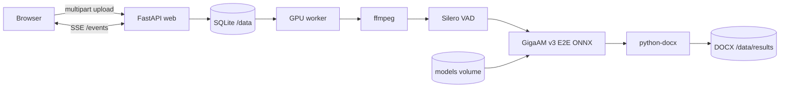

<p align="center">
  
</p>

<h1 align="center">GigaAM Transcriber</h1>

<p align="center">
  <strong>Локальная транскрибация русской речи → DOCX</strong><br>
  <strong>Local Russian speech transcription → DOCX</strong>
</p>

<p align="center">
  <a href="https://github.com/frizeone/gigaam-transcriber"></a>
  
  
  
  
  
  
</p>

<p align="center">
  <a href="#-русский">🇷🇺 Русский</a> ·
  <a href="#-english">🇬🇧 English</a> ·
  <a href="README.md">📖 README</a> ·
  <a href="VALIDATION.md">✅ Validation</a> ·
  <a href="DECISIONS.md">🧭 Decisions</a>
</p>

---

## 🇷🇺 Русский

### Что это

**GigaAM Transcriber** — production-ready веб-сервис, который принимает видео или аудио, распознаёт русскую речь моделью **GigaAM v3 E2E (Сбер)** и отдаёт готовый **.docx**. Всё работает локально: аудио не отправляется в облака, а после первой загрузки весов интернет не нужен.

Сервис рассчитан на машину с **NVIDIA GPU 16 ГБ** и разворачивается одной командой `docker compose up -d --build`.

### ✨ Возможности

| | |
|---|---|
| 🎙 **Видео и аудио** | MP4, MKV, MOV, AVI, WEBM, WAV, MP3, M4A, FLAC, OGG и другие |
| 🧠 **GigaAM v3 E2E** | RNNT (точнее) или CTC (быстрее), fp32/int8 |
| ✂️ **Потоковая обработка** | ffmpeg → WAV 16 кГц моно → Silero VAD → батчевый ASR; 3 часа без OOM |
| 📊 **Честный прогресс** | 0–10% — поиск речи, 10–99% — секунды распознанных сегментов; SSE + heartbeat |
| 📄 **DOCX** | Кириллица, `w:lang=ru-RU`, метаданные, таймкоды, нумерация страниц |
| 🧵 **Очередь** | SQLite + один GPU-воркер, отмена, удаление, TTL, восстановление после рестарта |
| 🖥 **UI** | Drag & drop, история, превью, восстановление после F5, тёмная адаптивная тема |
| 🔒 **Безопасность** | Опциональный `AUTH_TOKEN`, rate limit, CSP, security-заголовки, non-root, без CORS |
| 🐳 **Docker** | Один образ для web и worker, GPU только воркеру, CPU base + GPU override |
| 🌐 **Офлайн** | Веса в named volume `models`; `HF_HUB_OFFLINE=1` после `make init` |

### 🏗 Архитектура



- **web** — API, статика, валидация, SSE. GPU не нужен.
- **worker** — один процесс, модели в памяти, батчевый ASR, graceful shutdown.
- **models-init** — одноразовая загрузка весов в volume `models`.
- **data** — SQLite, временные uploads/WAV, готовые DOCX.
- Redis/Celery не нужны: очередь и события живут в SQLite.

### 🚀 Быстрый старт

```bash
git clone https://github.com/frizeone/gigaam-transcriber.git
cd gigaam-transcriber
cp .env.example .env

make init     # веса GigaAM v3 E2E RNNT/CTC + Silero VAD
make up       # GPU → http://localhost:8000
```

Без GNU make:

```bash
docker compose --profile init run --rm --build models-init
docker compose -f docker-compose.yml -f docker-compose.gpu.yml up -d --build
```

CPU-режим:

```bash
make cpu      # ASR_DEVICE=cpu, ASR_QUANT=int8
```

Остановка без удаления данных:

```bash
make down     # volume data и models сохраняются
```

### 📈 Проверенные результаты

| Сценарий | Результат |
|---|---|
| Часовой MP4, RNNT fp32, RTX 4070 Ti Super 16 ГБ | **39.5 с**, **91× реального времени**, пик VRAM 4.0 ГБ |
| 3-часовой WAV (тишина) | 26.6 с, RSS worker 1.1–1.9 ГБ, валидный DOCX «Речь не обнаружена» |
| 16-секундный русский WAV | 0.67 с, RTF 0.041 |
| CPU int8, 16 секунд | 3.37 с, RTF 0.21 |
| Тесты | `pytest`: 56 passed, 1 skipped; `ruff`, `mypy` — чисто |
| Образ | 9.05 ГБ uncompressed; `docker save`-архив — **3.38 ГБ** |

### 🧪 Тесты и качество

```bash
make test       # pytest в контейнере, FakeTranscriber, без GPU
make lint       # ruff
make typecheck  # mypy
make smoke      # реальная модель в контейнере worker
```

Покрыто: DOCX/OOXML, кириллица, таймкоды, пустой результат, склейка абзацев, API-контракты и коды ошибок, санитизация имён, SQLite-очередь, отмена, рестарт воркера, полный цикл с `FakeTranscriber`, статика без CDN.

### 📄 Пример результата

[`samples/example.docx`](samples/example.docx) — реальный документ, сгенерированный из синтетической русской речи: заголовок, таблица метаданных, текст с таймкодами и футер «Страница X из Y».

### 🧭 Решения и ограничения

- Для 3-часовых файлов используется собственный потоковый VAD-конвейер, а не загрузка всего WAV в память.
- `onnxruntime-gpu==1.24.4` зафиксирован под CUDA 12.8 + cuDNN 9 (ORT ≥1.27 собран с CUDA 13).
- Один GPU-воркер — осознанный выбор для 16 ГБ VRAM.
- Диаризация, SRT/VTT/PDF, LLM-суммаризация и OAuth — вне MVP, архитектура готова к расширению.
- Word/LibreOffice визуально не проверялись в CI; OOXML валидируется `python-docx`/`zipfile`.

### 🏷 Теги

`gigaam` · `gigaam-v3` · `russian-asr` · `speech-to-text` · `transcription` · `onnx` · `onnxruntime` · `cuda` · `silero-vad` · `fastapi` · `python` · `docker` · `docker-compose` · `self-hosted` · `local-first` · `docx` · `sse` · `sqlite`

---

## 🇬🇧 English

### What it is

**GigaAM Transcriber** is a production-ready web service that accepts video or audio, recognizes Russian speech with **GigaAM v3 E2E (Sber)**, and returns a ready-to-use **.docx**. Everything runs locally: audio never leaves the server, and after the first model download no internet access is required.

Built for a machine with an **NVIDIA GPU and 16 GB VRAM**, deployed with a single `docker compose up -d --build` command.

### ✨ Features

| | |
|---|---|
| 🎙 **Video & audio** | MP4, MKV, MOV, AVI, WEBM, WAV, MP3, M4A, FLAC, OGG and more |
| 🧠 **GigaAM v3 E2E** | RNNT (more accurate) or CTC (faster), fp32/int8 |
| ✂️ **Streaming pipeline** | ffmpeg → 16 kHz mono WAV → Silero VAD → batched ASR; 3 hours without OOM |
| 📊 **Honest progress** | 0–10% speech detection, 10–99% recognized audio seconds; SSE + heartbeat |
| 📄 **DOCX** | Cyrillic, `w:lang=ru-RU`, metadata, timestamps, page numbering |
| 🧵 **Queue** | SQLite + one GPU worker, cancel, delete, TTL, crash recovery |
| 🖥 **UI** | Drag & drop, history, preview, F5 restore, dark responsive theme |
| 🔒 **Security** | Optional `AUTH_TOKEN`, rate limiting, CSP, security headers, non-root, no CORS |
| 🐳 **Docker** | One image for web and worker, GPU exposed only to the worker, CPU base + GPU override |
| 🌐 **Offline** | Weights in the `models` named volume; `HF_HUB_OFFLINE=1` after `make init` |

### 🏗 Architecture


- **web** — API, static frontend, validation, SSE. No GPU required.
- **worker** — single process, models kept in memory, batched ASR, graceful shutdown.
- **models-init** — one-off model download into the `models` volume.
- **data** — SQLite, temporary uploads/WAV files, finished DOCX files.
- No Redis/Celery: the queue and events live in SQLite.

### 🚀 Quick start

```bash
git clone https://github.com/frizeone/gigaam-transcriber.git
cd gigaam-transcriber
cp .env.example .env

make init     # download GigaAM v3 E2E RNNT/CTC + Silero VAD
make up       # GPU → http://localhost:8000
```

Without GNU make:

```bash
docker compose --profile init run --rm --build models-init
docker compose -f docker-compose.yml -f docker-compose.gpu.yml up -d --build
```

CPU mode:

```bash
make cpu      # ASR_DEVICE=cpu, ASR_QUANT=int8
```

Stop without deleting data:

```bash
make down     # data and models volumes are preserved
```

### 📈 Measured results

| Scenario | Result |
|---|---|
| 1-hour MP4, RNNT fp32, RTX 4070 Ti Super 16 GB | **39.5 s**, **91× real time**, 4.0 GB peak VRAM |
| 3-hour WAV (silence) | 26.6 s, worker RSS 1.1–1.9 GB, valid “Speech not detected” DOCX |
| 16-second Russian WAV | 0.67 s, RTF 0.041 |
| CPU int8, 16 seconds | 3.37 s, RTF 0.21 |
| Tests | `pytest`: 56 passed, 1 skipped; `ruff`, `mypy` clean |
| Image | 9.05 GB uncompressed; `docker save` archive — **3.38 GB** |

### 🧪 Tests and quality

```bash
make test       # pytest in a container, FakeTranscriber, no GPU
make lint       # ruff
make typecheck  # mypy
make smoke      # real model inside the worker container
```

Covered: DOCX/OOXML, Cyrillic, timestamps, empty result, paragraph grouping, API contracts and error codes, filename sanitization, SQLite queue, cancellation, worker restart, full FakeTranscriber cycle, no-CDN static frontend.

### 📄 Result example

[`samples/example.docx`](samples/example.docx) — a real document generated from synthetic Russian speech: title, metadata table, timestamped text and “Page X of Y” footer.

### 🧭 Decisions and limitations

- Long files use a custom streaming VAD pipeline instead of loading the whole WAV into memory.
- `onnxruntime-gpu==1.24.4` is pinned for CUDA 12.8 + cuDNN 9 (ORT ≥1.27 is built with CUDA 13).
- A single GPU worker is intentional for a 16 GB GPU.
- Diarization, SRT/VTT/PDF, LLM summaries and OAuth are outside the MVP; the architecture is ready for them.
- Word/LibreOffice were not visually tested in CI; OOXML is validated with `python-docx`/`zipfile`.

### 🏷 Tags

`gigaam` · `gigaam-v3` · `russian-asr` · `speech-to-text` · `transcription` · `onnx` · `onnxruntime` · `cuda` · `silero-vad` · `fastapi` · `python` · `docker` · `docker-compose` · `self-hosted` · `local-first` · `docx` · `sse` · `sqlite`

---

<p align="center">
  <sub>Made with ❤️ for local, private Russian speech recognition.</sub><br>
  <sub>MIT License · GigaAM v3 · onnx-asr · Silero VAD</sub>
</p>
